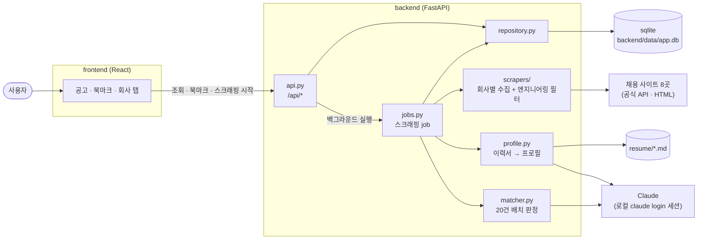
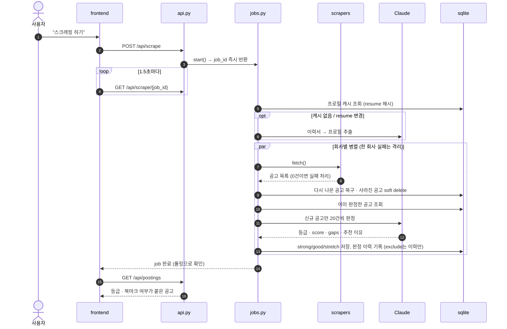

# job-posting

등록된 회사(네이버, 카카오, 쿠팡, 토스, 당근, 라인, 삼성전자, 현대자동차)의 채용 사이트를 읽어 내 이력서에 맞는 엔지니어링 포지션을 등급(strong / good / stretch)과 함께 보여주는 로컬 앱.

- 설계: [design/specs/](design/specs/) · 계획: [design/plans/](design/plans/) · PoC 기록: [design/poc.md](design/poc.md)
- LLM은 Claude Agent SDK + 로컬 Claude Code 로그인 세션(`claude login`)을 사용. API key 불필요. 개인 로컬 용도 전용

## 준비
- Python 3.14+, [uv](https://docs.astral.sh/uv/), Node 20+, Claude Code CLI(`claude login` 완료)
- `ANTHROPIC_API_KEY`는 설정하지 않음 (있으면 세션 대신 키가 쓰임)

## 이력서 준비
프로젝트 루트에 `resume/` 디렉토리를 만들고 이력서를 Markdown(`.md`) 파일로 넣는다. 디렉토리 안의 `*.md`를 전부 읽어 프로필(기술·연차·도메인·희망 조건)을 추출하고, 이를 기준으로 공고를 판정한다.
```
resume/
  resume.md            # 이력서
  career_portfolio.md  # 경력기술서 (선택)
  preferences.md       # 희망 근무지/비자/도메인/역할 (선택)
```
- 파일명·개수는 자유. 하위 디렉토리는 읽지 않음
- `resume/`는 gitignore 대상이라 커밋되지 않음
- 파일 내용이 바뀌면 다음 실행 때 프로필을 다시 추출

## 실행 ([just](https://github.com/casey/just))
```bash
just setup     # 의존성 설치 (uv sync + npm install)
just run       # 프론트 빌드 + 백엔드 실행 → http://localhost:8000
```
개발 시: `just dev` → 백엔드(reload, 8000) + 프론트 Vite(5173, `/api` 프록시) 동시 실행, http://localhost:5173. 전체 목록은 `just`.

just 없이:
```bash
cd frontend && npm install && npm run build
cd backend && uv sync && uv run python -m app --port 8000
```

## 사용
1. 공고 탭에서 **스크래핑 하기** → 8개사 병렬 수집 → 신규 공고만 LLM 판정 → 등급이 매겨진 공고 저장
2. 첫 실행은 약 300건을 판정하므로 수 분 / 구독 사용량 $5 상당. 이후 실행은 신규 공고만
3. 세션이 만료되면 배너가 뜸 → 터미널에서 `claude login` 후 다시 시도

## 테스트
```bash
just test        # 백엔드 + 프론트 단위 테스트 (네트워크/LLM 없음). 따로: just test-api / just test-web
just test-live   # 실제 채용 사이트 호출
```

## 디버그
- `just scrape [company...]`: 스크래퍼만 실행, `backend/out/<company>.json`
- `just match [company] [--limit N] [--planted]`: 파일 기반 매칭, `backend/out/fit.md`
- `just auth`: 세션 인증 확인 · `just reset-db`: 공고·판정 이력 삭제

## 동작

### 구성

- 스크래핑은 httpx로 짠 결정적 코드이고, LLM은 프로필 추출과 공고 판정에만 쓴다
- LLM은 API key 없이 로컬 Claude Code 로그인 세션으로 호출한다

### 스크래핑 한 번의 흐름

- 세션이 만료되면 job이 `auth_required`로 끝나고, 다음 실행에서 판정 못 한 공고만 다시 판정한다
- 북마크는 공고와 JOIN으로 묶여 있어서, 공고가 삭제되면 같이 숨겨지고 공고가 다시 나타나면 같이 돌아온다

## 구조
```
backend/app/   scrapers/ (회사별 구현체·registry) · llm.py · profile.py · matcher.py · repository.py · jobs.py · api.py
backend/scripts/  디버그용 단독 실행 스크립트 (just scrape / just match)
frontend/src/  App.tsx · api.ts · components/ (PostingsTab, BookmarksTab, CompaniesTab, PostingCard, ScrapeProgress, ScrollTopButton)
design/        specs/ · plans/ · ui-sample.html · poc.md · poc-results/
```
모듈별 상세는 [backend/AGENTS.md](backend/AGENTS.md), [frontend/AGENTS.md](frontend/AGENTS.md).
새 회사 추가 = `backend/app/scrapers/<company>.py`에 `Scraper` 구현체 추가 (Greenhouse면 `GreenhouseScraper` 상속).
